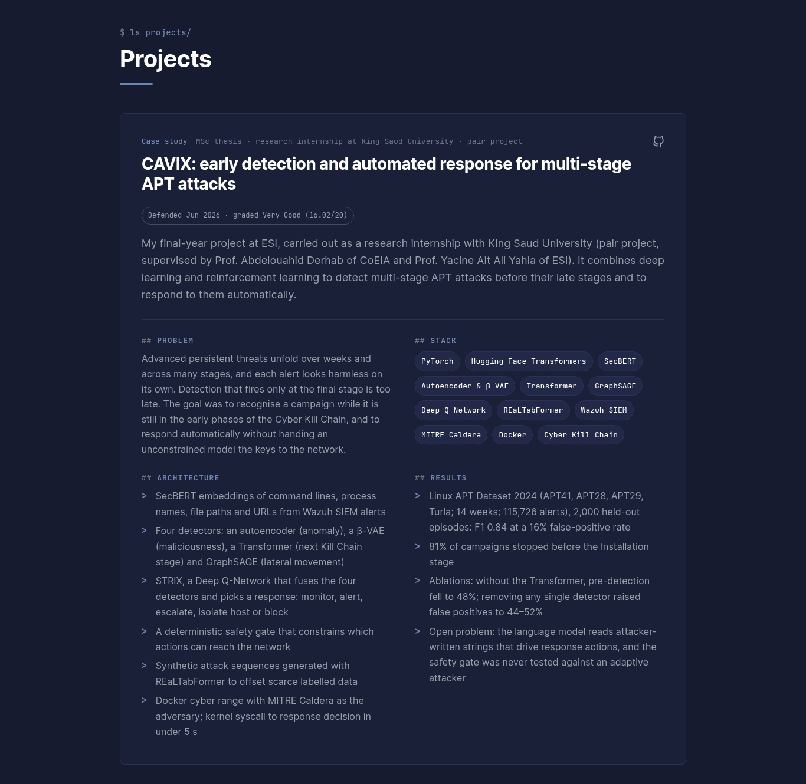
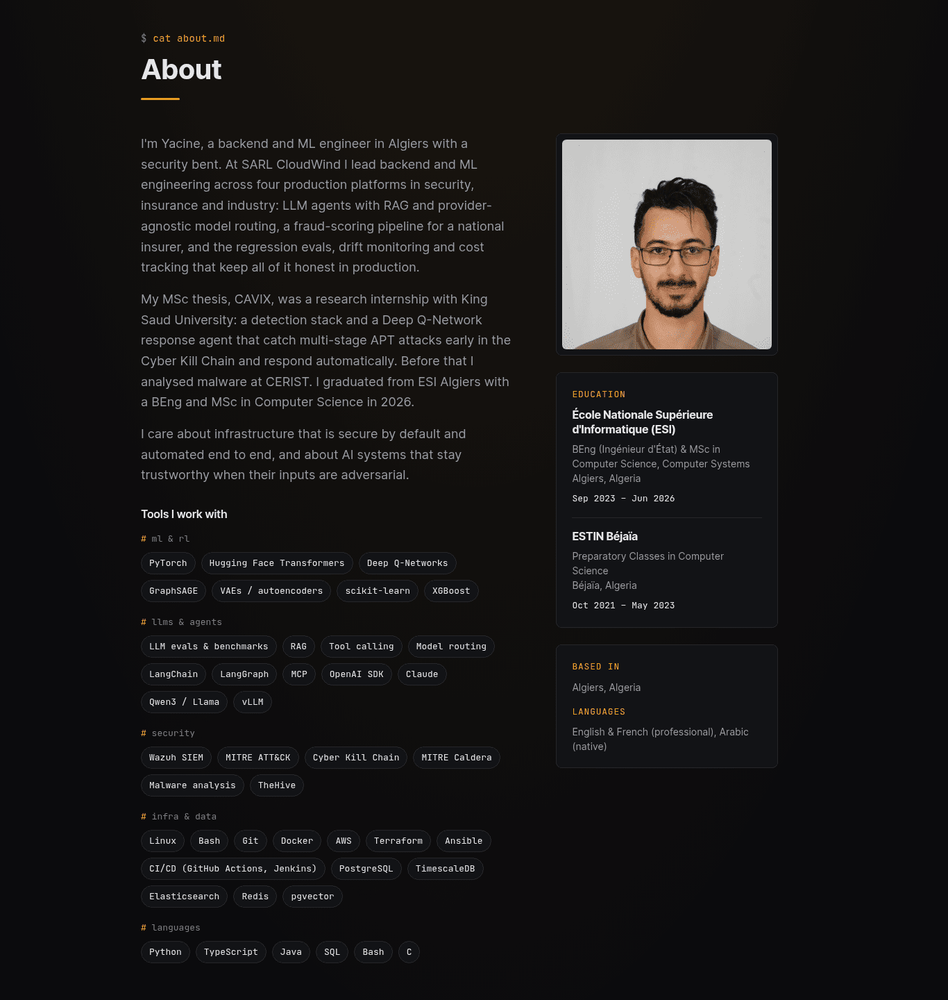
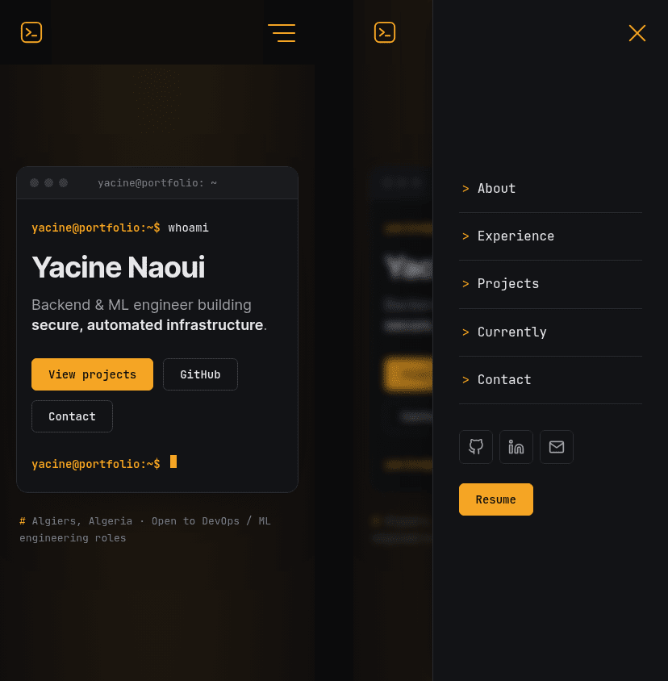

<div align="center">
  
</div>
<h1 align="center">Yacine Naoui — portfolio</h1>
<p align="center">
  Personal site of <strong>Yacine Naoui</strong>, backend &amp; ML engineer building secure, automated infrastructure.<br />
  Built with <a href="https://www.gatsbyjs.com/">Gatsby</a> and <a href="https://styled-components.com/">styled-components</a>.
</p>

> Designed &amp; built by Yacine Naoui · Originally based on [Brittany Chiang's v4](https://brittanychiang.com) ([bchiang7/v4](https://github.com/bchiang7/v4), MIT). The content, theme and layout here are my own; see [LICENSE](LICENSE) for the original notice.


## Screenshots

| Projects: case-study card with problem, stack, architecture and results |    About: bio, grouped skills, education     |
| :---------------------------------------------------------------------: | :------------------------------------------: |
|                       |  |

<p align="center">
  
</p>

## Stack

- Gatsby 3 (static site, image pipeline, markdown content), React 17, styled-components
- Self-hosted fonts: [Inter](https://rsms.me/inter/) for text, [JetBrains Mono](https://www.jetbrains.com/lp/mono/) for code (via `@fontsource`)
- Node 22 (see `.nvmrc`), Yarn 1. Gatsby 3 needs `NODE_OPTIONS=--openssl-legacy-provider` on Node 17+; the npm scripts set it
- GitHub Actions runs lint + build on every push and pull request (`.github/workflows/ci.yml`)

## Running it

```sh
nvm install          # uses the version in .nvmrc
yarn                 # install dependencies
yarn start           # dev server at http://localhost:8000
```

Production build and preview:

```sh
yarn build           # outputs to public/
yarn serve           # serves public/ at http://localhost:9000
yarn lint            # eslint over the whole repo
```

Commits run prettier and eslint on staged files through husky + lint-staged.

## Where things live

| What                                                    | Where                                                                                             |
| ------------------------------------------------------- | ------------------------------------------------------------------------------------------------- |
| Email, socials, nav, resume URL, education, "Currently" | `src/config.js`                                                                                   |
| Site title / description / URL / Twitter handle         | `gatsby-config.js` → `siteMetadata`                                                               |
| Experience entries                                      | `content/jobs/<Company>/index.md` (one folder per role)                                           |
| Featured case studies                                   | `content/featured/<Project>/index.md`                                                             |
| Other projects grid                                     | `content/projects/*.md` (copy `_template.md`, set `showInProjects: true`)                         |
| Hero / About copy                                       | `src/components/sections/hero.js`, `about.js`                                                     |
| Colours, fonts, spacing                                 | `src/styles/variables.js` (single `--accent`; swap the four `--accent*` values for electric blue) |
| Photo                                                   | `src/images/me.jpg`                                                                               |
| Resume                                                  | `static/resume.pdf` (linked from the header while `resumeUrl` is set)                             |
| Favicon / app icon source                               | `src/images/logo.png`                                                                             |
| Social preview image                                    | `static/og.png`, `static/og@2x.png`                                                               |

Case-study frontmatter (`content/featured/*/index.md`):

```yaml
title: 'Project name'
role: 'What I did / context'
status: 'In progress'
github: '' # optional
external: '' # optional
cover: './cover.png' # optional image
tech: [Python, Docker]
problem: >-
  One paragraph on the problem.
architecture:
  - 'Component one'
results:
  - 'Measured outcome'
```


## License

MIT. The original work is © 2018 Brittany Chiang; modifications are © 2026 Yacine Naoui.
